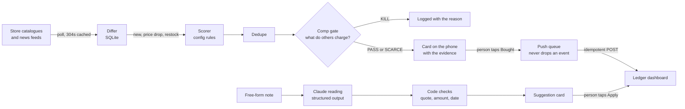
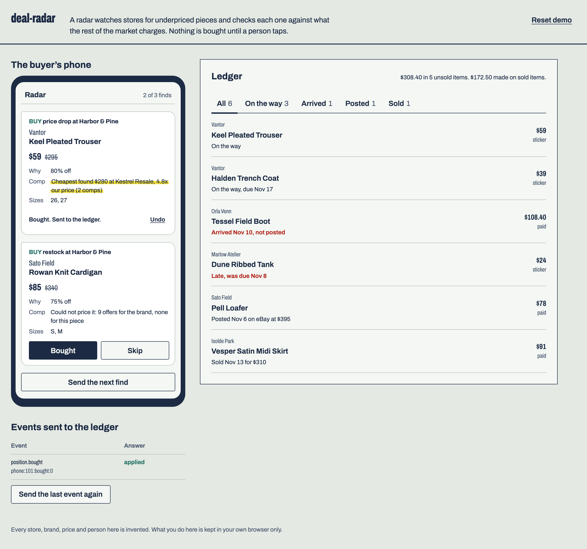
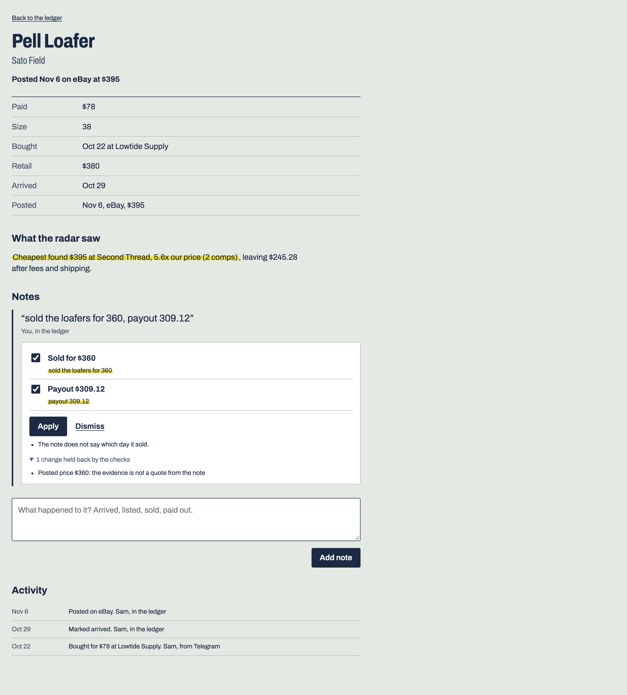

# deal-radar

Agents find the deals, a person approves every buy.

[](https://github.com/Logan-Cope/deal-radar/actions/workflows/ci.yml)


deal-radar watches online stores for underpriced pieces, checks each find against what the rest of the market charges, and sends a card to a person's phone with the evidence attached. The person taps Bought or Skip. A buy lands in a ledger, where a free-form note like "listed the boots on ebay yesterday for 425" is read by Claude into suggested changes, each with the quote that backs it. Nothing is written until the person taps Apply, and nothing in this repository can spend money.

It is a public rewrite of a radar I run for my own resale buying. Every store, brand, price and person in it is invented, and the demo runs on fixtures with no API keys.

**Live demo: [deal-radar-ledger.vercel.app](https://deal-radar-ledger.vercel.app)**. Tap Bought on a card, open an item, try a sample note. What you do is kept in your own browser, and no key is involved.

## Run it in two minutes

No keys, no network, no accounts.

```bash
# the radar: three poll cycles against four fictional stores served locally
cd radar
uv sync
uv run deal-radar demo

# the ledger dashboard
cd ../dashboard
npm install
npm run dev        # http://localhost:3000
```

Python 3.11+ with [uv](https://docs.astral.sh/uv/), and Node 20.12+.

To watch the two halves talk, start the dashboard with a token and point the demo's buy at it:

```bash
cd dashboard && RADAR_TOKEN=dev LEDGER_PASSWORD=dev npm run dev
cd radar && uv run deal-radar demo --push http://localhost:3000 --token dev
#   ledger push: demo:tap:1 applied      (run it again: duplicate)
```

With `RADAR_TOKEN` set the dashboard is one shared ledger instead of a demo, so the browser asks for `LEDGER_PASSWORD` (any user name).

## How it works



The radar (`radar/`, Python) polls each store's public catalogue once per cycle, diffs it against the last cycle, and scores what changed. A find that clears the discount bar goes to the **comp gate**, which searches for the same item at other sellers and only lets it through when the cheapest credible offer is far above ours. The matching rules, the outlier guard and the "scarce" verdict are in [`radar/src/deal_radar/comps.py`](radar/src/deal_radar/comps.py).

The ledger (`dashboard/`, Next.js) takes the radar's events through one endpoint that applies each event exactly once, and keeps every buy from card to sale. Its stage (on the way, arrived, posted, sold) is derived from dates, never stored.

The detail, with diagrams of every path, is in [docs/ARCHITECTURE.md](docs/ARCHITECTURE.md). The reasons behind the design are in [docs/DECISIONS.md](docs/DECISIONS.md).

## What one demo run prints

`uv run deal-radar demo` runs three cycles against the fixture stores. Trimmed from one run (product links and two of the four cards cut):

```text
== Cycle 2 ==
  harbor-and-pine  6 items, 4 changed
  atelier-nord     5 items, 2 changed
  lowtide-supply   304 not modified
  glasshouse       error: 200 but not JSON (bot wall?) (benched)
  comp gate  Arden Wrap Dress Ink: KILL, $150 at Bayside Outlet is only 1.2x, -$8 headroom (3 comps)
  comp gate  Mira Shoulder Bag Clay: KILL, $2,400 at Resale Row is 13x the cheapest Isolde Park offer ($190) on only 1 match, likely the wrong comp

    #1 BUY · Price drop
    Orla Venn, Tessel Field Boot Tan
    harbor-and-pine · $96.00 (was $640.00, -85%)
    Sizes: 37, 38, 39, 40
    Why: watchlist brand at -85%
    Comp: cheapest found $410 at Northline Goods, 4.3x our price (3 comps)

    #3 WATCH · New find
    Vantor, Halden Trench Coat Stone
    atelier-nord · $39.00
    Why: $39 with no list price (possible pricing error)
    Comp: cheapest found $420 at Northline Goods, 10.8x our price (3 comps)

  5 passed the scorer, 0 deduped, 2 stopped by the comp gate, 3 carded

== Cycle 3 ==
  dedupe     Tessel Field Boot Tan: carded at $96, now $92 (-4%), needs -10% to card again

== A person decides ==
  Bought on #1: bought, a position.bought event is queued for the ledger
  Skip on #2: skipped, recorded on the alert, nothing is queued

== Heartbeat ==
    Watching 4 stores · 4 alerts in the last 24h
    Benched: glasshouse
    Ledger queue: 1 waiting, 0 parked
```

The first cycle is silent on purpose: the first sight of a store is a baseline, not 250 alerts. CI runs this demo on every push.

## The ledger and the note reader

| The ledger after a tap | A note read into suggestions |
|---|---|
|  |  |

The reader makes one structured-output call to `claude-opus-5-5` per note, then [`lib/reader/check.ts`](dashboard/lib/reader/check.ts) drops anything code can verify is wrong: evidence that is not a quote from the note, an amount its own evidence does not contain, a date after the note was written. What the checks held back is shown on the card rather than hidden. The demo answers from fixture readings in the model's exact output shape. Live readings run on a shared ledger only, where each note is read once:

```bash
RADAR_TOKEN=dev LEDGER_PASSWORD=dev READER=claude ANTHROPIC_API_KEY=... npm run dev
```

## Guardrails

- **No automated checkout.** The radar finds and checks; a person decides on every card.
- **Nothing writes from a note without a tap,** and one Undo takes back a whole Apply. Apply is refused if the item changed after the note was read.
- **Every radar event is applied once.** The event id is an idempotency key, so a retry after a timeout answers `duplicate`.
- **A phone Undo cannot delete an item someone has worked on** in the ledger. It answers `stale` and the item stays.
- **The radar never drops a decision.** Events wait in a SQLite queue with backoff, in order, until the ledger settles them.
- **Polite polling.** Public catalogue endpoints only, one request per store per cycle, conditional requests, and a store that keeps failing is benched instead of hammered.
- **Taps only count from the configured chat.** A Telegram update from any other chat is ignored.
- **No keys in the demo,** and the radar's write endpoint is off unless `RADAR_TOKEN` is set. A shared ledger refuses to serve without `LEDGER_PASSWORD`, and every server action checks it, not only the proxy.

## Tests and evals

```bash
cd radar && uv run pytest && uv run ruff check . && uv run mypy
cd dashboard && npm run check && npm run test:e2e
cd dashboard && npm run eval:reader
```

- **Radar:** 45 tests over the differ, scorer, comp gate, store benching, the push queue, Telegram taps and the full three-cycle run against the local fixture server.
- **Dashboard:** 62 unit tests (event idempotency, the reader's checks, Apply and Undo, demo replay, stages, the API route, shared-mode access) and 5 Playwright flows on desktop and phone viewports. The same flows run against the live demo with `BASE_URL=https://deal-radar-ledger.vercel.app npm run test:e2e`.
- **Reader eval:** 7 cases written before the reader, including a question, a store's promise and an injection attempt that must produce nothing. The gate is precision 1.0 (nothing wrong reaches a person) and recall 0.9. CI scores the fixture readings through the real checks; `READER=claude npm run eval:reader -- --runs 3` scores the live model on the same cases.

## Running it for real

1. Copy `radar/config.example.yaml` to `radar/config.yaml` and list your stores. `uv run deal-radar probe <url>` says whether a store publishes a catalogue.
2. Set what you want in the environment. Nothing is required: with no variables set, cards go to the terminal and the outbox file.

| Variable | Where | What it turns on |
|---|---|---|
| `TELEGRAM_BOT_TOKEN`, `TELEGRAM_CHAT_ID` | radar | Cards in a Telegram chat with Bought and Skip buttons; taps from any other chat are ignored |
| `SERPER_API_KEY` | radar | Live comp lookups (`comps.source: serper` in the config) |
| `RADAR_TOKEN`, `LEDGER_PASSWORD` | dashboard | Shared mode: one real ledger behind a password, and the radar's push endpoint |
| `LEDGER_URL`, `LEDGER_TOKEN` | radar | Where to push decisions; `LEDGER_TOKEN` is the dashboard's `RADAR_TOKEN` |
| `READER=claude`, `ANTHROPIC_API_KEY` | dashboard | Live note readings, in shared mode |

3. Run it:

```bash
uv run deal-radar poll --loop     # every ~5 minutes with jitter
uv run deal-radar listen          # answer Telegram taps as they happen
```

## Layout

```text
radar/       Python: sources, differ, scorer, comp gate, cards, push queue, CLI, fixtures
dashboard/   Next.js: ledger, event endpoint, note reader, evals, unit and e2e tests
docs/        ARCHITECTURE.md, DECISIONS.md, media
```

## License

MIT
