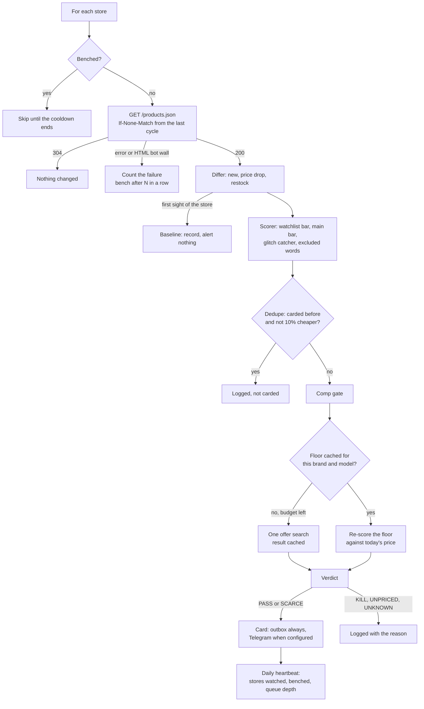
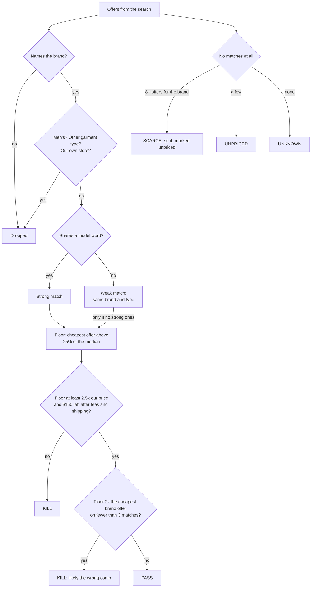
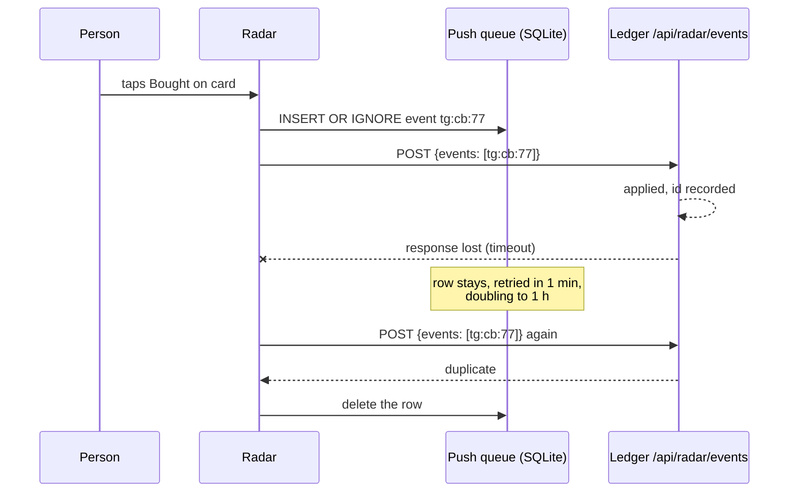
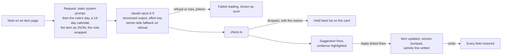
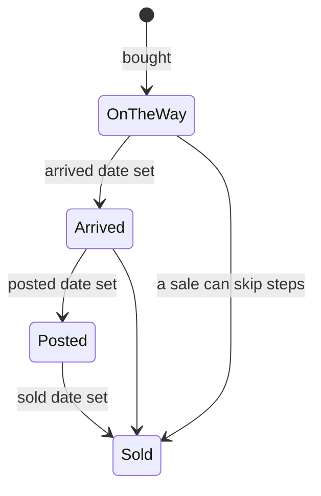

# Architecture

Two programs and one contract between them. The radar (`radar/`, Python) finds and checks deals and carries a person's decisions out. The ledger (`dashboard/`, Next.js) keeps every buy from card to sale and reads a person's notes into suggested changes. The contract is a list of events, each with an id the ledger applies exactly once.

## 1. One radar cycle

| Piece | Where | What it does |
|---|---|---|
| Catalogue poller | `radar/src/deal_radar/sources/shopify.py` | Page 1 of `/products.json`, cheapest in-stock variant, sizes in stock, and a `NotACatalogue` error for a 200 that is really a bot wall |
| Differ and state | `radar/src/deal_radar/store.py` | SQLite (WAL): last-seen items, alerts and decisions, the comp cache, HTTP caching headers, store health, the push queue |
| Scorer and dedupe | `radar/src/deal_radar/scoring.py` | Config rules with accent folding; restocks skip the dedupe price check |
| Comp gate | `radar/src/deal_radar/comps.py` | Matching, the credible floor, the verdict, the thin-evidence guard |
| Offer sources | `radar/src/deal_radar/sources/offers.py` | A fixture source for the demo and tests, and a shopping search API for real use |
| Drop screen | `radar/src/deal_radar/sources/rss.py` | Keyword screen over news feeds for collab and capsule releases |
| Cards | `radar/src/deal_radar/alerts/` | One renderer for the terminal and the JSONL outbox, one for Telegram HTML with every scraped string escaped |
| Engine and CLI | `radar/src/deal_radar/engine.py`, `cli.py` | One cycle end to end, Telegram taps and replies, `demo`, `poll`, `listen`, `decide`, `push`, `probe` |
| Fixture server | `radar/src/deal_radar/fixture_server.py` | Serves the fictional stores over real HTTP with ETags, so the demo and tests exercise the real fetch path |

### The comp gate

A markdown is the seller's claim; a comp is evidence. For each find the gate searches for the same piece elsewhere and asks how far the cheapest credible offer sits above our price.

The floor is the expensive half (a paid lookup) and stable, so it is cached by brand and model and the colourway is ignored. The ratio depends on our price, which moves, so a cached floor is re-scored every time. The demo shows both: the wrap dress is killed in cycle 2 with a live lookup and again in cycle 3 from the cache at its new price.

## 2. Getting a decision to the ledger exactly once

A tap on Bought, a tap on Undo, or a reply to a card becomes an event in the radar's SQLite push queue before anything goes over the network. The queue drains in order, 50 events per request, and only the ledger's answer settles a row.

| Answer | Meaning | Radar does |
|---|---|---|
| `applied` | The event changed the ledger | Deletes the row |
| `duplicate` | This id was seen before | Deletes the row |
| `stale` | The event no longer applies (an Undo after someone worked on the item) | Deletes the row |
| `rejected` | The event is malformed; the error names the field | Parks the row for a person, never resends it |
| anything else, network error, 5xx | Unknown | Keeps the row and backs off |

The queue stops at the first row still backing off instead of skipping past it, so a note can never reach the ledger before the buy it belongs to.

On the ledger side (`dashboard/lib/ledger/events.ts`):

- `position.bought` creates the item. If the alert is already in the ledger, it fills only empty fields, so a repeat never overwrites a person's edit.
- `position.removed` deletes the item only while nothing but the radar has written to it. Once a person has applied a note or added one, the undo answers `stale`.
- `position.note` attaches the reply to the item.
- Every id with a usable shape is recorded with its answer, rejected ones included, so a retry of a bad event is `duplicate` rather than a second error.

The demo shows this on screen: each tap's event and answer appears in "Events sent to the ledger", and "Send the last event again" resends the identical event to show `duplicate`.

## 3. A note becomes a suggestion

- **The prompt is static.** Everything about the note goes in the user message, so the system prompt is a stable prefix between notes.
- **Dates come from a calendar, not arithmetic.** The model gets the last 14 days with weekday names, so "yesterday" or "on saturday" is a lookup.
- **The checks enforce in code what the prompt asks in words** (`dashboard/lib/reader/check.ts`): the item is a candidate; the evidence is a quote from the note; a money value appears in its own evidence; a date is real, not after the note and not before the purchase; the marketplace is one the ledger tracks; nothing equal to the current value; one value per field.
- **Apply is version-checked.** A note remembers the item's version when it was read. If the item changed since, Apply is refused with a reason, and Undo is refused if a newer edit would be overwritten.
- **Tests never call the model.** The reader takes an injected `complete`; the demo and CI use fixture readings in the model's exact output shape, run through the same checks. Two fixtures carry a deliberate slip so the checks can be seen working.

## 4. Stages are derived, not stored

An item's stage is whichever date it has furthest along. One status line per row ("Late, was due Nov 8", "Posted Nov 6 on eBay at $395") replaces a status column and a badge. Only late items and arrivals waiting to be posted get the attention color.

## 5. Where the demo keeps its data

The public demo gives every visitor a private sandbox in server memory, keyed by a cookie and seeded fresh. Sandboxes are capped and the least recently used is dropped. A server restart resets everything. With `RADAR_TOKEN` set, the app switches to one shared ledger and enables `/api/radar/events` for a real radar. A shared ledger needs `LEDGER_PASSWORD`: the proxy asks for it with HTTP Basic, `session()` checks it again for every page and server action, the demo-only controls (the phone, the event replay, the reset) are refused, and without a password set the app answers 503 rather than serve an open ledger. The production system this is rewritten from keeps the ledger in Postgres; the event and suggestion logic is the same, which is why it lives in plain functions over a state object rather than in route handlers.
